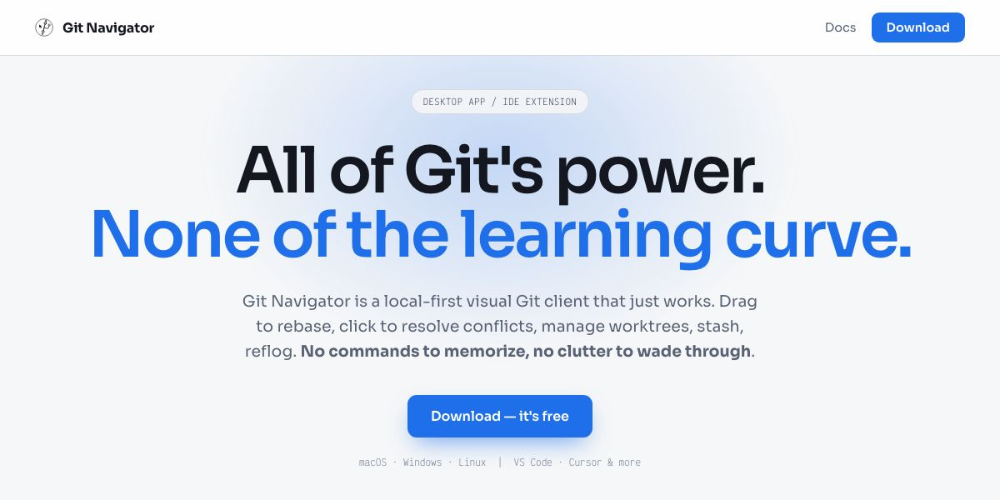

# @globetrotte/altimeter - Altimeter

A simple cli for generating preview image of a given url(s) with [Playwright](https://playwright.dev/).

## Getting started

For a quick one-off, pass a URL directly.

```sh
> altimeter https://gitnav.xyz --dir doc/preview
Generated doc/preview/base.jpg
```

For anything more, create a config file called `altimeter.config.json` in your project.

```json
{
  "baseURL": "https://gitnav.xyz",
  "dir": "doc/preview"
}
```

Then run altimeter with no arguments (or pass the path to a config file with a different name).

```sh
> altimeter
Generated doc/preview/base.jpg
```

Open up the `doc/preview` directory, aaand tadaa! there's an image called `base.jpg` that looks like this in there!



The first run downloads the Playwright build of the configured browser (only the headless shell for Chromium) if it isn't installed yet. To use a browser that's already on the machine instead, set [`channel`](#channel) or [`executablePath`](#executablepath).

Run `altimeter --help` to see the command-line options; they override the matching config values (eg. `altimeter --format png --scale 2`).

Altimeter exits with a non-zero code if the config is invalid or any screenshot fails, so it can be used in CI as-is. Pages that respond with an HTTP error status (eg. 404) count as failures.

## Config

Here's a list of things that can be set with the config file. Relative paths (like `dir`) are resolved from the config file's directory, not from where altimeter is run.

The config is validated before any browser is launched: invalid values are all reported together, and unknown keys (eg. a typo like `baseUrl`) produce a warning.

### **browser**

- Type: `BrowserTypes` (`"chromium" | "firefox" | "webkit"`)
- Default: `"chromium"`

Browser type to use for generating the screenshots.

### **channel**

- Type: `string` (eg. `"chrome"`, `"msedge"`)
- Default: `undefined`

Use an installed browser distribution instead of downloading the Playwright build. See [Playwright's docs](https://playwright.dev/docs/browsers#google-chrome--microsoft-edge) for supported channels.

### **executablePath**

- Type: `string`
- Default: `undefined`

Path to a browser executable to use instead of downloading the Playwright build.

### **baseURL** (required)

- Type: `string` (eg. `"https://gitnav.xyz"`)
- Default: `undefined`

This is basically the base URL of the site you want to take screenshots of.

### **destURLs**

- Type: `(string | AltimeterDestination)[]` (eg. `"docs/drag-and-drop-rebase.html"` or `{"name": "drag_and_drop_rebase", "url": "docs/drag-and-drop-rebase.html"}`)
- Default: `[]`

Pages to take screenshots of, as paths on top of `baseURL`. With `"docs/drag-and-drop-rebase.html"` (and `"https://gitnav.xyz"` as baseURL), it would take the screenshot of `https://gitnav.xyz/docs/drag-and-drop-rebase.html`.

The image name is derived from the path (`docs-drag-and-drop-rebase.jpg` here; `""` or `index.html` becomes `base`). Use the object form to pick a `name` yourself, eg. `"drag_and_drop_rebase"` saves `drag_and_drop_rebase.jpg`.

The object form can also override any of the [page options](#page-options) for that page only:

```json
{
  "baseURL": "https://gitnav.xyz",
  "hideSelectors": ["#cookie-banner"],
  "destURLs": [
    "",
    "docs/intro.html",
    { "name": "intro-dark", "url": "docs/intro.html", "colorScheme": "dark" }
  ]
}
```

If this is empty, it would take a screenshot of the base url and save it as `base.jpg`.

### **dir**

- Type: `string`
- Default: `"altimeter"`

Directory where all the preview images should be saved to, relative to the config file.

### **timeout**

- Type: `number` (milliseconds)
- Default: `30000`

Maximum time to wait for navigation and `waitForSelector`. `0` disables the timeout.

### **concurrency**

- Type: `number`
- Default: `4`

Maximum number of pages captured at the same time.

### **httpCredentials**

- Type: `{ "username": string, "password": string }`
- Default: `undefined`

Credentials for HTTP authentication, eg. on a password-protected staging site.

## Page options

These can be set at the top level of the config, or per page in [`destURLs`](#desturls).

### **width**

- Type: `number`
- Default: `1200`

Width of the preview images. The default 1200x630 is the recommended Open Graph image size.

### **height**

- Type: `number`
- Default: `630`

Height of the preview images.

### **deviceScaleFactor**

- Type: `number`
- Default: `1`

Pixel density of the images, eg. `2` produces 2400x1260 images for sharper previews on high-density screens.

### **format**

- Type: `"jpeg" | "png"`
- Default: `"jpeg"`

Image format. Files are saved as `.jpg` or `.png`.

### **quality**

- Type: `number` (0 to 100)
- Default: `undefined` (Playwright's default)

JPEG quality. Ignored for PNG.

### **colorScheme**

- Type: `"light" | "dark" | "no-preference"`
- Default: `"light"`

Value of the `prefers-color-scheme` media feature.

### **reducedMotion**

- Type: `"reduce" | "no-preference"`
- Default: `"reduce"`

Value of the `prefers-reduced-motion` media feature. Defaults to `"reduce"` so pages that respect it don't get captured mid-animation.

### **hideSelectors**

- Type: `string[]` (eg. `["#cookie-banner", ".chat-widget"]`)
- Default: `[]`

Elements to hide while the screenshot is taken, eg. cookie banners or chat widgets.

### **css**

- Type: `string`
- Default: `undefined`

Extra CSS applied while the screenshot is taken.

### **selector**

- Type: `string` (eg. `"#hero"`)
- Default: `undefined`

If set, captures only the first element matching this selector instead of the top of the page.

### **headers**

- Type: `Record<string, string>`
- Default: `undefined`

Extra HTTP headers sent with every request.

### **userAgent**

- Type: `string`
- Default: `undefined` (the browser's own)

User agent to send.

### **waitUntil**

- Type: `"load" | "domcontentloaded" | "networkidle" | "commit"`
- Default: `"load"`

Which load state to wait for after navigating to a page. `"networkidle"` waits until there has been no network activity for 500ms, which may never happen on pages with analytics, chat widgets or polling.

### **waitForSelector**

- Type: `string` (eg. `"#hero"`)
- Default: `undefined`

If set, waits for an element matching this selector to be visible before taking the screenshot.

### **delay**

- Type: `number` (milliseconds)
- Default: `0`

Extra time to wait before taking the screenshot, eg. for fonts or animations to settle.

## Using it as a library

```ts
import { genRun } from "@globetrotte/altimeter";

const results = await genRun({
  baseURL: "https://gitnav.xyz",
  destURLs: ["", "docs/intro.html"],
});
for (const { name, path, error } of results) {
  console.log(name, error ? "failed: " + error.message : path);
}
```

`genRun` accepts the same options as the config file (missing ones use the defaults, and the options are validated the same way) and never throws for a single page failing; check `error` on each result instead. Unlike the CLI, relative paths are resolved from the current working directory.
